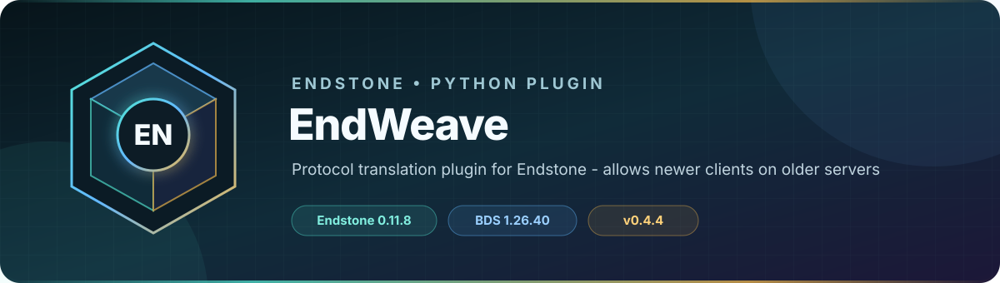

<!-- endstone-professional-header:start -->
<p align="center">
  
</p>

<p align="center">
  <a href="https://github.com/TheNINJALLO/endstone-endweave/actions/workflows/wheel-release.yml"></a>
  <a href="https://github.com/TheNINJALLO/endstone-endweave/releases/latest"></a>
</p>

<p align="center">
  
  
  
  =3.10" src="https://img.shields.io/badge/Python-%3E=3.10-3776AB?style=flat-square&amp;logo=python&amp;logoColor=white">
</p>

<p align="center">
  <strong>Protocol translation plugin for Endstone - allows newer clients on older servers.</strong>
</p>

<p align="center">
  <a href="#what-it-does">What it does</a> &bull;
  <a href="#how-to-use">How to use</a> &bull;
  <a href="#commands-and-permissions">Commands</a> &bull;
  <a href="#install">Install</a> &bull;
  <a href="https://github.com/TheNINJALLO/endstone-endweave/releases">Releases</a>
</p>

## Overview

Protocol translation plugin for Endstone - allows newer clients on older servers. This release is aligned with Endstone 0.11.8 and Minecraft Bedrock Dedicated Server 1.26.40, and is distributed as a Python wheel for direct installation in an Endstone server.

## What it does

- Translates supported Bedrock protocol packets so newer clients can join the targeted older server protocol.
- Rewrites inbound, outbound, and server-list-ping traffic through a per-player translation pipeline.
- Tracks translated sessions and notifies operators when an EndWeave update is available.

## How to use

1. Install the wheel and restart Endstone; no player-side mod is required.
2. Check startup logs for the advertised client/server protocol range before allowing production traffic.
3. Test joining with each client version you intend to support and remove the plugin if an unsupported protocol is used.

## Commands and permissions

This plugin registers no commands. Packet translation begins automatically for supported connections; operators with `endweave.update` receive update notices when they join.

## Compatibility

| Component | Supported version |
|---|---|
| Endstone | `0.11.8` |
| Endstone API | `0.11` |
| Bedrock Dedicated Server | `1.26.40` |
| Python | `>=3.10` |
| Plugin release | `v0.4.4` |

## Install

Download the wheel from the matching GitHub release:

```bash
gh release download v0.4.4 --repo TheNINJALLO/endstone-endweave --pattern "*.whl"
```

Copy the downloaded wheel into the server's `plugins/` directory, remove any older wheel for the same plugin, and restart Endstone.

> [!IMPORTANT]
> Use Endstone `0.11.8` with BDS `1.26.40`. Back up worlds and plugin data before upgrading a production server.

## Configuration and secrets

Runtime databases, logs, local `.env` files, server directories, and root `config.toml` files are excluded from source releases. When an example configuration is provided, copy it locally and keep live tokens, passwords, webhook URLs, and server identifiers out of Git.

## Release automation

Every `v*` tag runs [the wheel release workflow](.github/workflows/wheel-release.yml), builds the package in a clean GitHub runner, stores the wheel as a workflow artifact, and attaches it to the matching GitHub release.
<!-- endstone-professional-header:end -->

---

## Project guide

> Seamlessly interweaving Bedrock protocol versions.

[](https://github.com/EndstoneMC/endweave/actions/workflows/build.yml)

An [Endstone](https://github.com/EndstoneMC/endstone) plugin that lets Bedrock clients connect to servers with
different protocol versions by rewriting packets at the network layer. Inspired by [ViaVersion](https://github.com/ViaVersion/ViaVersion).

## Supported Versions

| Minecraft Version   | Protocol |
|---------------------|----------|
| 1.21.120            | 859      |
| 1.21.124            | 860      |
| 1.21.130 - 1.21.132 | 898      |
| 1.26.0 - 1.26.3     | 924      |
| 1.26.10 - 1.26.13   | 944      |
| 1.26.20             | 975      |

## Quick Start

1. Download the latest `.whl` from [Releases](https://github.com/EndstoneMC/endweave/releases)
2. Drop it in your server's `plugins/` folder
3. Restart the server

Players on newer clients will connect transparently. No additional configuration needed.

## How It Works

Endweave handles protocol differences between Minecraft versions, allowing players to join servers on different protocol
versions. Whether a client is newer or older than the server, packets are translated in real time. Only fields that
actually changed get rewritten, and players already on the server's version go through zero extra processing. When a
client is multiple versions away from the server, translators are automatically chained together to bridge the gap.

## Contributing

Issues and PRs welcome on [GitHub](https://github.com/EndstoneMC/endweave/issues).

## License

[Apache License 2.0](LICENSE)
